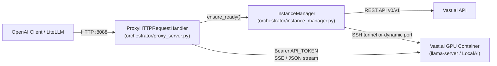

# vast-on-demand

On-demand, scale-to-zero OpenAI-compatible LLM inference proxy and custom `llama.cpp` container for Vast.ai spot and on-demand GPUs.

[](LICENSE)
-3776AB.svg)
[](https://github.com/mur-labs/vast-on-demand/actions/workflows/docker-build-push.yml)

---

## Overview

`vast-on-demand` lets you use open-weight GGUF models on rented Vast.ai GPUs through any OpenAI-compatible client (such as LiteLLM, OpenCode, or `curl`) without paying for idle GPU time.

When a request arrives at the local proxy (`http://127.0.0.1:8088/v1`), the Python orchestrator selects the cheapest qualifying Vast.ai host, provisions a container with an ephemeral API token, waits for the model to download and pass health checks, and streams responses back. After a configurable idle period (default: 10 minutes), a background reaper automatically destroys (or stops) the instance.

**Intended audience:** Researchers, developers, and individual users who want private, pay-per-use GPU inference on Vast.ai without keeping instances running 24/7 or installing Docker locally.

---

## Key Features

- **Lazy provisioning with retry deduplication:** Concurrent requests arriving while an instance is booting wait on a shared condition variable instead of launching duplicate GPU rentals.
- **Cost-optimal host selection:** Queries Vast.ai for verified hosts meeting minimum hardware/network criteria (`>= 20 GB` VRAM, `>= 40 GB` disk, `>= 500 Mbps` download, `>= 97%` reliability) and sorts by lowest hourly cost (`dph_total`).
- **Spot bidding with on-demand fallback:** Bids on spot/interruptible instances (`min_bid` + 20% buffer by default) and falls back to on-demand offers if no spot hosts match.
- **Zero-trust ephemeral credentials:** Generates a fresh `API_TOKEN` (`secrets.token_urlsafe(32)`) per instance; no Vast.ai keys or permanent credentials are passed into the remote container.
- **SSH tunnel + dynamic port resolution:** Automatically opens a local SSH port forward via [`deploy/ssh_tunnel.sh`](deploy/ssh_tunnel.sh) when SSH metadata is available, or falls back to Vast.ai's dynamic external port mapping.
- **Streaming-aware idle reaper:** Refreshes the activity timer while response chunks stream and tears down idle instances after `idle_timeout_seconds` (default: `600`s).
- **Zero third-party Python dependencies:** The entire orchestrator and test suite run on the Python standard library.

---

## Architecture



1. **Proxy (`orchestrator/proxy_server.py`):** Multithreaded HTTP server (`ThreadedTCPServer`) exposing `/status`, `/health`, and OpenAI-compatible routes (`GET`, `POST`, `OPTIONS`).
2. **Lifecycle Manager (`orchestrator/instance_manager.py`):** Thread-safe state machine (`STOPPED` -> `PROVISIONING` -> `READY` -> `DESTROYING`) managing instance reuse (`~/.vast_rental_llm_state.json`), health probes (`/health`, `/readyz`, `/v1/models`), and the background reaper thread.
3. **Vast.ai Client (`orchestrator/vast_client.py`):** Standard-library HTTP client handling offer filtering, spot/on-demand rental, instance listing, dynamic port resolution, and rate-limit (`429`) retries.
4. **Inference Container (`Dockerfile`, `entrypoint.sh`):** CUDA-enabled `ghcr.io/ggml-org/llama.cpp:server-cuda` image with `aria2c` (16-connection download), `curl`, and `ca-certificates`. Downloads `MODEL_URL` on boot and starts `llama-server` with `--api-key`.

---

## Requirements

- **Operating System:** Linux (the orchestrator uses standard Python, while [`start-orchestrator.sh`](start-orchestrator.sh) uses `fuser` and [`deploy/ssh_tunnel.sh`](deploy/ssh_tunnel.sh) uses `ssh`, `pgrep`, and `pkill`).
- **Python:** Python 3.x (tested on Python 3.12.3; standard library only—no `pip install` required).
- **External Account:** A [Vast.ai](https://vast.ai/) account with an API key (`VAST_API_KEY`) and billing credit.
- **Optional:**
  - SSH key at `~/.ssh/id_rsa` registered on Vast.ai for automatic SSH tunneling.
  - Hugging Face token (`HF_TOKEN`) if downloading gated models.
  - `aria2` / `curl` / `bash` (included inside the Docker image for remote execution).

---

## Installation

1. **Clone the repository:**
   ```bash
   git clone https://github.com/mur-labs/vast-on-demand.git
   cd vast-on-demand
   ```

2. **Create your `.env` file from the template:**
   ```bash
   cp .env.example .env
   ```
   Edit `.env` and set your Vast.ai API key:
   ```dotenv
   VAST_API_KEY=your_vast_api_key_here
   ```

3. **Verify the local installation by running the test suite:**
   ```bash
   python3 -m unittest discover -s tests -v
   ```
   All 26 unit tests run offline using mocks and subprocess checks (no Docker daemon or Vast.ai billing required).

---

## Configuration

[`orchestrator/config.py`](orchestrator/config.py) loads environment variables from `.env` in the repository root (if present) without overriding existing shell environment variables.

| Variable | Default | Description |
| :--- | :--- | :--- |
| `VAST_API_KEY` | `None` (required for live rentals) | Vast.ai API key used in `Authorization: Bearer` headers. |
| `MODEL_URL` | `Qwen2.5-14B-Instruct-Q4_K_M.gguf` (Bartowski) | Direct GGUF download URL passed to the container. |
| `HF_TOKEN` | `None` | Optional Hugging Face token for gated model downloads. |
| `CTX_SIZE` | `32768` | Context window passed to `llama-server` (`-c`) / LocalAI. |
| `RENTAL_DOCKER_IMAGE` | `ghcr.io/mur-labs/vast-on-demand:latest` (CLI)<br>`localai/localai:v4.11.0-gpu-nvidia-cuda-12` (`OrchestratorConfig`) | Container image to launch on Vast.ai. |
| `CONTAINER_PORT` | `8080` | Internal port exposed by the inference server inside the container. |
| `VAST_SPOT_INSTANCES` | `true` | Use spot (`bid`) instances (`true`/`1`/`yes`) or on-demand (`false`). |
| `VAST_BID_BUFFER` | `0.20` | Bid buffer ratio added above `min_bid` (e.g., `0.20` = +20%). |
| `VAST_IDLE_ACTION` | `destroy` | Action on idle timeout: `destroy` (ephemeral) or `stop` (keeps disk/weights). |
| `RENTAL_API_TOKEN` | Random 32-byte URL-safe token | Optional fixed bearer token for the remote inference server. |

Default host selection criteria in [`HostCriteria`](orchestrator/config.py#L28):
- `min_vram_gb`: `20.0`
- `min_disk_gb`: `40.0`
- `min_inet_down_mbps`: `500.0`
- `min_reliability`: `0.97`

---

## Usage

### Start the Orchestrator

```bash
./start-orchestrator.sh
```

Or run the Python module directly with CLI options:

```bash
python3 orchestrator/main.py --port 8088 --idle-timeout 600 --mode spot
```

Supported CLI flags (`python3 orchestrator/main.py --help`):
- `--host` (default: `127.0.0.1`)
- `--port` (default: `8088`)
- `--idle-timeout` (default: `600` seconds)
- `--image` (default: `$RENTAL_DOCKER_IMAGE` or `ghcr.io/mur-labs/vast-on-demand:latest`)
- `--model-url` (override `MODEL_URL`)
- `--mode {spot,on-demand}` (default: `spot`)

### Send Inference Requests

Point any OpenAI-compatible client at `http://127.0.0.1:8088/v1`:

```bash
curl http://127.0.0.1:8088/v1/chat/completions \
  -H "Content-Type: application/json" \
  -d '{
    "model": "qwen2.5-14b-instruct",
    "messages": [{"role": "user", "content": "Briefly explain epistemic uncertainty."}]
  }'
```

The first request triggers GPU provisioning and weight download (which can take several minutes depending on host bandwidth). Subsequent requests reuse the active instance until it is idle for `idle_timeout_seconds`.

Check orchestrator state at any time:

```bash
curl http://127.0.0.1:8088/status
```

Returns JSON such as `{"status": "STOPPED"}`, `{"status": "PROVISIONING"}`, or `{"status": "READY"}`.

### Forking & Building the Container Image

The default image `ghcr.io/mur-labs/vast-on-demand:latest` is built from [`Dockerfile`](Dockerfile) and [`entrypoint.sh`](entrypoint.sh) with no baked-in secrets or weights (`MODEL_URL`, `API_TOKEN`, and `HF_TOKEN` are injected at runtime). If you fork the repository, [`.github/workflows/docker-build-push.yml`](.github/workflows/docker-build-push.yml) builds and pushes `ghcr.io/<your-user>/vast-on-demand:latest` on push to `main` or `master` (or via manual `workflow_dispatch`). Pass `--image ghcr.io/<your-user>/vast-on-demand:latest` or set `RENTAL_DOCKER_IMAGE` in `.env`.

### Live Validation & Benchmark Scripts

- **Dry-run benchmark:**
  ```bash
  python3 tests/benchmark_academic.py --dry-run
  ```
- **End-to-end Vast.ai Stage D validation** (provisions a live GPU, runs 5 academic prompts, tears down the instance in `finally`):
  ```bash
  python3 scripts/run_stage_d.py --mode on-demand
  ```

---

## Project Structure

```text
.
├── .env.example                        # Environment variable template
├── .github/workflows/
│   └── docker-build-push.yml           # GitHub Actions GHCR build/push pipeline
├── Dockerfile                          # Custom llama.cpp CUDA server image
├── LICENSE                             # MIT License
├── README.md
├── deploy/
│   └── ssh_tunnel.sh                   # Local SSH port-forwarding helper
├── entrypoint.sh                       # Container boot script (download + llama-server)
├── orchestrator/
│   ├── __init__.py
│   ├── config.py                       # .env loader, HostCriteria, ModelConfig, OrchestratorConfig
│   ├── instance_manager.py             # State machine, provisioning, health checks, idle reaper
│   ├── main.py                         # CLI entrypoint and signal handlers
│   ├── proxy_server.py                 # Multithreaded OpenAI-compatible HTTP proxy
│   └── vast_client.py                  # Vast.ai REST API v0/v1 client
├── scripts/
│   └── run_stage_d.py                  # Live end-to-end provisioning and benchmark runner
├── start-orchestrator.sh               # Convenience launcher (clears :8088 and runs main.py)
└── tests/
    ├── benchmark_academic.py           # 5-workload academic inference benchmark
    ├── test_entrypoint.py              # Container entrypoint subprocess tests
    ├── test_instance_manager.py        # Concurrency, reuse, preemption, reaper tests
    ├── test_proxy_server.py            # Lazy provisioning, forwarding, error handling tests
    └── test_vast_client.py             # API payload, filtering, sorting, endpoint tests
```

---

## How It Works

1. **Request Interception:** `ProxyHTTPRequestHandler` drains the incoming request body and calls `InstanceManager.ensure_ready()`.
2. **State Machine & Reuse:** If `state` is `STOPPED`, the calling thread transitions it to `PROVISIONING`; concurrent threads wait on `self._state_condition`. `_provision_instance()` checks `~/.vast_rental_llm_state.json` and `VastClient.list_instances()` for an existing `vast-on-demand` / `rental-llm` or saved instance to reuse before searching for a new host.
3. **Provisioning & Readiness:** `VastClient.search_offers()` filters verified offers and sorts by hourly price. `VastClient.launch_instance()` rents the best offer with an ephemeral `API_TOKEN`. `_await_instance_ready()` polls Vast.ai, attempts to start an SSH tunnel on a free local port via `deploy/ssh_tunnel.sh`, and verifies `/health` (or `/readyz`) plus authenticated `/v1/models` access.
4. **Proxying & Teardown:** Requests are forwarded with `Authorization: Bearer <ephemeral_token>` and streamed in 4 KB chunks. On `idle_timeout_seconds` of inactivity, `SIGINT`/`SIGTERM`, or unrecoverable connection failure (`mark_failed`), the instance is destroyed (or stopped if `VAST_IDLE_ACTION=stop`) and the SSH tunnel is closed.

---

## Testing and Development

Run all unit tests:

```bash
python3 -m unittest discover -s tests -v
```

Check shell script syntax:

```bash
bash -n entrypoint.sh start-orchestrator.sh deploy/ssh_tunnel.sh
```

Logs are emitted to stdout/stderr via Python's `logging` module (`INFO` level). When using `./start-orchestrator.sh`, any existing process bound to port `8088` is terminated with `fuser -k 8088/tcp` before starting.

---

## Known Limitations

- **Cold-start download time:** With `VAST_IDLE_ACTION=destroy` (default), model weights are stored on ephemeral container disk and re-downloaded on every new rental.
- **Linux shell tooling:** `start-orchestrator.sh` (`fuser`) and `deploy/ssh_tunnel.sh` (`pgrep`, `pkill`, `ssh`) assume a Linux environment.
- **Hardcoded SSH key path:** `InstanceManager._await_instance_ready()` passes `~/.ssh/id_rsa` to `deploy/ssh_tunnel.sh`; if your Vast.ai SSH key uses a different path or you have no key there, SSH tunneling will be skipped in favor of direct dynamic port mapping.
- **Localhost trust model:** The local proxy (`127.0.0.1:8088`) does not require authentication from local clients; it injects the ephemeral `API_TOKEN` when forwarding to the remote GPU.
- **Supported HTTP methods:** `ProxyHTTPRequestHandler` implements `GET`, `POST`, and `OPTIONS` only.

---

## Contributing

Issues and pull requests are welcome. See [`CONTRIBUTING.md`](CONTRIBUTING.md) for guidelines. Before submitting a PR:

1. Run `python3 -m unittest discover -s tests -v` and ensure all tests pass.
2. Ensure no secrets, API keys, or local `.env` files are included in your diff.

---

## License and Acknowledgements

- **License:** [MIT License](LICENSE)
- **Inference & Container Stack:** Built on [`ggml-org/llama.cpp`](https://github.com/ggml-org/llama.cpp) (`ghcr.io/ggml-org/llama.cpp:server-cuda`), [`aria2`](https://aria2.github.io/), and [Vast.ai](https://vast.ai/).
